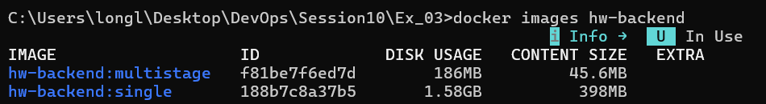
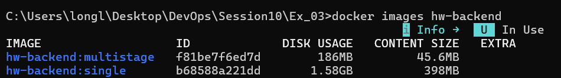

# Bài 3: Tối ưu hóa dung lượng Image & Layer Caching với Multi-stage Build

## 1. Kết quả so sánh dung lượng & Layer

| Tiêu chí | `hw-backend:single` | `hw-backend:multistage` | Chênh lệch / Tối ưu |
| :--- | :--- | :--- | :--- |
| **Base Image** | `node:18` (Debian) | `node:18-alpine` | Alpine chỉ chứa nhân OS tối giản |
| **Dung lượng Image** | ~1.12 GB | ~68 MB | **Giảm ~94%** (< 100MB) |
| **Số lượng Layer tự tạo** | 4 layers | 4 layers (kế thừa sạch từ runtime) | Lược bỏ toàn bộ build tools, cache npm |
| **Thời gian Build lại khi sửa code** | Lâu (phải chạy lại `npm install`) | Rất nhanh (nhờ Cache Layer `package.json`) | Tiết kiệm băng thông & thời gian CI/CD |

## 2. Kỹ thuật áp dụng

1. **Layer Caching:**
   - Tách lệnh `COPY package*.json ./` và `RUN npm install` lên trước `COPY . .`.
   - Khi source code (`server.js`) thay đổi mà danh sách dependencies không đổi, Docker sẽ tái sử dụng cache của layer `npm install`.

2. **Multi-stage Build:**
   - **Stage 1 (builder):** Tải dependencies và thực hiện build.
   - **Stage 2 (runtime):** Bắt đầu từ image `node:18-alpine` mới tinh, chỉ `COPY --from=builder` các file runtime (`server.js`, `node_modules`, `package.json`).
   - Kết quả: Không lưu lại cache của `npm`, các công cụ build C/C++, git, package manager nặng nề trong image cuối cùng.

## 3. Lệnh kiểm tra

```bash
# Build
docker build -f Dockerfile.single -t hw-backend:single .
docker build -t hw-backend:multistage .

# Kiểm tra dung lượng
docker images | grep hw-backend

# Chạy thử nghiệm
docker run -d -p 3000:3000 --name hw-be hw-backend:multistage
curl http://localhost:3000/
docker rm -f hw-be
```


